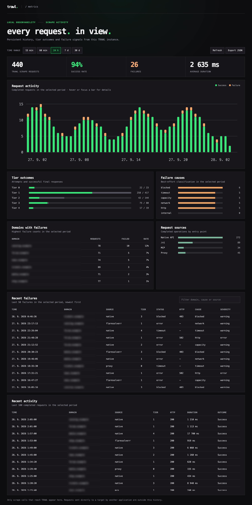

<h1 align="center">
  <a href="https://trawl.germondai.com" target="_blank">
    <br/><br/>
    <span>TRAWL</span>
  </a>
</h1>

Self-hosted web scraping for applications and AI agents. Get page content through an API or MCP, with built-in handling for supported browser challenges and CAPTCHAs.

TRAWL starts with HTTP, reuses verified clearance and opens Camoufox when a browser is needed. Repeat requests fetch fresh content without repeating a full solve whenever the site accepts the saved session.

[Website](https://trawl.germondai.com) · [Documentation](https://docs.trawl.germondai.com) · [Latest release](https://github.com/germondai/trawl/releases/latest)

## Features

- **Challenge handling:** Cloudflare, Anubis, Akamai, Imperva, DDoS-Guard and supported AWS WAF and DataDome flows. Built-in CAPTCHA paths include Turnstile, reCAPTCHA v2, hCaptcha, GeeTest Slide, ALTCHA, Friendly Captcha and CAP. [Coverage and limits](apps/docs/getting-started/challenge-support.md).
- **Fast repeat requests:** automatic HTTP clearance reuse, Redis or in-memory caching, and browser fallback when required. No named session is needed for shared clearance reuse.
- **MCP for agents:** read Markdown, scrape HTML, extract structured JSON, capture screenshots and inspect browser activity from known URLs.
- **Isolated browser sessions:** retain cookies, localStorage, sessionStorage and browser identity. Scrape within a session, keep a page open for JavaScript eval and read cookies. [Session API](apps/docs/api-reference/browser-sessions.md).
- **API and forward proxy:** use `/scrape`, the FlareSolverr-compatible `/v1` endpoint, or a challenge-aware HTTP/HTTPS proxy with WebSockets and Range support.
- **Local dashboard:** persistent request history, tier outcomes, failure causes and live updates.
- **Local solving by default:** optional 2Captcha fallback and opt-in Firefox TLS/HTTP2 impersonation; Bun fetch remains the default HTTP transport.

## Sponsors

<details open>
  <summary>View/Collapse All</summary>

  <table>
    <tr>
      <td width="30%" align="center" valign="middle">
        <a href="https://get.brightdata.com/trawl" target="_blank">
          
        </a>
      </td>
      <td valign="middle">
        <b><a href="https://get.brightdata.com/trawl" target="_blank">Bright Data</a></b> - The most powerful platform for Web Unlocker, SERP API and web scraping tools.<br><br>
        <b>Why <a href="https://get.brightdata.com/trawl" target="_blank">Bright Data</a>?</b><br>
        • <a href="https://get.brightdata.com/trawl-web-unlocker" target="_blank">Web Unlocker</a> - bypass any anti-bot protection<br>
        • <a href="https://get.brightdata.com/trawl-serp-api" target="_blank">SERP API</a> - real-time Google, Bing & more results<br>
        • Scraping Browser & dedicated scrapers<br>
        • Massive residential proxy network<br>
        • Built for scale and reliability<br><br>
        <b>Get started for free with <a href="https://get.brightdata.com/trawl" target="_blank">Bright Data</a>!</b>
      </td>
    </tr>
    <tr>
      <td width="30%" align="center" valign="middle">
        <a href="https://go.nodemaven.com/germondaioctoberGH" target="_blank">
          
        </a>
      </td>
      <td valign="middle">
        <b><a href="https://go.nodemaven.com/germondaioctoberGH" target="_blank">NodeMaven</a></b> - The most efficient proxy provider for Web Scrapping and Automation with the Highest Quality IP on the market.<br><br>
        <b>Why <a href="https://go.nodemaven.com/germondaioctoberGH" target="_blank">NodeMaven</a>?</b><br>
        • ZIP targeting<br>
        • 99.9% uptime<br>
        • IP filtering: all proxies have fraud score <97%<br>
        • No KYC required<br>
        • Unique free tools: Proxy Bandwidth Checker, Meta Tag Checker, IP Lookup and others!<br><br>
        <b>Special codes for <a href="https://trawl.germondai.com" target="_blank">TRAWL</a> users:</b><br>
        • <code>TRAWL35</code> - 35% off to Mobile and Residential Proxies<br>
        • <code>TRAWL40</code> - 40% off to ISP (Static) Proxies
      </td>
    </tr>
  </table>
</details>

## Performance

Selected same-machine comparisons show faster first and repeat responses than FlareSolverr and Byparr on the default Cloudflare workload:

| Protected page          | Best first | Best repeat |
| ----------------------- | ---------: | ----------: |
| NopeCHA Cloudflare demo |  **6.0 s** |  **879 ms** |
| 1337x                   |  **3.8 s** |   **85 ms** |
| EZTV                    |  **4.6 s** |  **473 ms** |

Measured **2026-10-17** on a development build after v1.8.0. These are verified minima from the recorded sample. First requests used a warm browser with an empty target cache; repeats are fresh fetches with reusable clearance. Results vary by site, IP and session state.

[Full comparison, medians and CPU/RAM](benchmarks/RESULTS.md) · [Method](benchmarks/README.md) · [Performance guide](apps/docs/getting-started/performance.md)

## Quick start

Run one browser with MCP, an in-memory clearance cache and persistent dashboard history:

```bash
docker run -d --name trawl \
  -p 127.0.0.1:8191:8191 \
  --shm-size=1gb \
  -e SESSION_CACHE_DRIVER=memory \
  -e BROWSER_POOL_SIZE=1 \
  -e MCP_ENABLED=true \
  -e METRICS_DASHBOARD_ENABLED=true \
  -v trawl_metrics:/data/metrics \
  ghcr.io/germondai/trawl:1.9.3

curl http://localhost:8191/health
```

Open [the local dashboard](http://localhost:8191/dashboard). Keep the API and MCP endpoint on a trusted network; dashboard history survives container recreation through the mounted volume.

For Redis and Compose deployments, see the [quick-start guide](apps/docs/getting-started/quick-start.md) and [Compose examples](apps/docs/deployment/docker-compose.md). Use `:1.9.3-baseline` on older CPUs or NAS hardware.

<details>
<summary>Dashboard preview</summary>



The screenshot uses illustrative traffic. Your dashboard shows requests actually handled by your instance. [Metrics setup](apps/docs/api-reference/health-stats.md#local-metrics-dashboard).

</details>

## API

### Native scraping

```bash
curl -X POST http://localhost:8191/scrape \
  -H 'Content-Type: application/json' \
  -d '{"url":"https://nopecha.com/demo/cloudflare","solveEmbeddedCaptchas":false}'
```

Returns HTML, cookies, the winning tier and timings. Set `solveEmbeddedCaptchas: false` for page content only; omit it to attempt supported embedded form widgets. Access challenges still need to clear. A delivered page does not by itself prove a form CAPTCHA was solved.

[Native API](apps/docs/api-reference/native-api.md) · [Custom headers](apps/docs/api-reference/custom-headers.md)

### Prowlarr, Jackett and FlareSolverr clients

```bash
curl -X POST http://localhost:8191/v1 \
  -H 'Content-Type: application/json' \
  -d '{"cmd":"request.get","url":"https://nopecha.com/demo/cloudflare"}'
```

Set your client's FlareSolverr URL to `http://trawl:8191` on a shared Docker network, or the TRAWL host address otherwise. `/v1` prioritizes page delivery and skips optional embedded widget solving by default.

[Prowlarr setup](apps/docs/integrations/prowlarr.md) · [Jackett setup](apps/docs/integrations/jackett.md) · [Compatibility reference](apps/docs/api-reference/flaresolvr-compat.md)

### MCP for AI clients

With `MCP_ENABLED=true`, connect your client using **Streamable HTTP** at `http://localhost:8191/mcp` or the TRAWL host address. Tools: `read`, `scrape`, `extract`, `screenshot` and `inspect`, plus the `scrape_url` compatibility alias.

TRAWL loads known public URLs; it does not provide web search. Existing browser sessions can be reused with `sessionId`. [MCP guide](apps/docs/integrations/mcp.md).

### Browser sessions

Create an isolated session and pass its ID on subsequent requests:

```bash
curl -X POST http://localhost:8191/sessions \
  -H 'Content-Type: application/json' \
  -d '{"id":"research"}'

curl -X POST http://localhost:8191/scrape \
  -H 'Content-Type: application/json' \
  -d '{"url":"https://nopecha.com/demo/cloudflare","sessionId":"research","solveEmbeddedCaptchas":false}'

curl -X DELETE http://localhost:8191/sessions/research
```

Sessions preserve browser storage between requests and keep login state out of the shared clearance cache. Requests within one session are sequential. Sessions expire when idle and do not survive an API restart; open tabs are closed after each request.

[Session API, authentication and lifecycle](apps/docs/api-reference/browser-sessions.md)

## Challenge and CAPTCHA support

TRAWL detects supported walls and runs the matching browser flow before returning content. Coverage includes JavaScript and proof-of-work challenges, interactive controls, and supported CAPTCHA widget variants.

Some challenges need a particular browser mode, a different egress IP or an external provider. For example, DataDome Device Check uses the opt-in headful pool; built-in hCaptcha support does not include image grids. Passive reCAPTCHA v3 scripts are not treated as blocking widgets.

The optional 2Captcha fallback supports captured Cloudflare Challenge Pages and supported declarative Turnstile/reCAPTCHA v2 widgets without a site profile. Other documented tasks require a site profile. It is disabled without a provider key; paid-service acceptance remains unverified.

[Full coverage matrix and external task catalogue](apps/docs/getting-started/challenge-support.md) · [Solver configuration](apps/docs/getting-started/configuration.md#optional-external-captcha-solver)

## HTTP/HTTPS forward proxy

Enable `MITM_ENABLED=true` and point your HTTP-compatible client at port `8192`. Normal traffic is forwarded directly; detected challenge responses escalate through TRAWL's browser tiers. HTTPS clients must trust the generated TRAWL CA. Keep the proxy private and persist its CA directory.

[Proxy setup](apps/docs/proxy/overview.md) · [Install the CA](apps/docs/proxy/ca-installation.md) · [Prowlarr and other clients](apps/docs/proxy/client-setup.md)

## Docker images

| Tags                             | Use case                             |
| -------------------------------- | ------------------------------------ |
| `:latest`, `:1.9.3`              | Standard release for modern hardware |
| `:baseline`, `:1.9.3-baseline`   | Older x86 CPUs and NAS kernels       |
| `:nightly`, `:nightly-<dev-sha>` | Development builds from `dev`        |

All tags use `ghcr.io/germondai/trawl`. Both release variants are published for Linux AMD64 and ARM64. [Standalone containers and source builds](apps/docs/deployment/standalone.md).

<details>
<summary>Compose variants and NAS app catalogs</summary>

- [docker-compose.yml](docker-compose.yml): scraper and Redis.
- [docker-compose.minimal.yml](docker-compose.minimal.yml): scraper with in-memory caching.
- [docker-compose.prod.yml](docker-compose.prod.yml): Redis, restart policy and health checks.
- [TrueNAS Community Apps](https://apps.truenas.com/catalog/trawl_community/) and [Unraid Community Apps](https://ca.unraid.net/apps/trawl-1o4q23p06utr4h): community-maintained packages.

</details>

## Configuration

| Setting                               | Default | Purpose                                                   |
| ------------------------------------- | ------- | --------------------------------------------------------- |
| `BROWSER_POOL_SIZE`                   | `1`     | Warm browsers available for concurrent work               |
| `SESSION_CACHE_DRIVER`                | `redis` | Choose Redis or single-process `memory` caching           |
| `SCRAPE_MAX_TIMEOUT_MS`               | `60000` | Default scrape deadline; request timeouts take precedence |
| `TIER1_TRANSPORT`                     | `bun`   | Set `wreq` for optional Firefox TLS/HTTP2 impersonation   |
| `BROWSER_SESSION_MAX_ENTRIES`         | `4`     | Maximum named browser sessions per instance               |
| `PROXY_URL` / `RESIDENTIAL_PROXY_URL` | unset   | Optional upstream proxies and proxy pools                 |

[All settings](apps/docs/getting-started/configuration.md) · [Environment example](.env.example) · [Upgrade guide](apps/docs/deployment/configuration-migration.md)

## Documentation and development

- [Architecture and tier routing](apps/docs/architecture/tiered-execution.md)
- [Clearance cache and HTTP reuse](apps/docs/architecture/session-cache.md)
- [Browser pool and resource management](apps/docs/architecture/browser-pool.md)
- [Troubleshooting](apps/docs/deployment/troubleshooting.md)
- [Release history](CHANGELOG.md)
- [Contributing and local development](CONTRIBUTING.md)

<details>
<summary>Monorepo structure and stack</summary>

| Workspace          | Purpose                                            |
| ------------------ | -------------------------------------------------- |
| `apps/api`         | Bun + Elysia API, MCP, dashboard and forward proxy |
| `apps/web`         | Nuxt landing page                                  |
| `apps/docs`        | VitePress documentation                            |
| `packages/browser` | Camoufox pool and clearance cache                  |
| `packages/tiers`   | Routing, browser sessions and challenge solvers    |
| `packages/types`   | Shared types                                       |

</details>

## Star History

<a href="https://www.star-history.com/?repos=germondai%2Ftrawl">
 <picture>
   <source media="(prefers-color-scheme: dark)" srcset="https://api.star-history.com/chart?repos=germondai/trawl&type=date&theme=dark&legend=top-left" />
   <source media="(prefers-color-scheme: light)" srcset="https://api.star-history.com/chart?repos=germondai/trawl&type=date&legend=top-left" />
   
 </picture>
</a>

## Contributors

<a href="https://github.com/germondai/trawl/graphs/contributors">
  
</a>

---

<p align="center">
    <span>Made with ❤️ by</span>
    <a href="https://github.com/germondai" target="_blank">@germondai</a>
</p>
